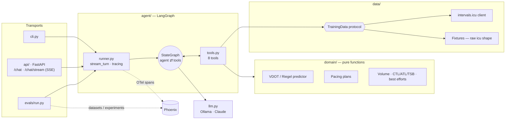

# 🏃 Running Coach Agent — POC

An agentic running coach that answers questions about **your intervals.icu data** ("Could I run a sub-2:55 marathon?", "How was my run today?", "Am I fresh for VMA tomorrow?"). It has **Arize Phoenix** tracing and an **eval suite** that gates CI.

Stack: Python 3.13 · **uv** · **LangGraph** (explicit `StateGraph`) + LangChain · **Ollama** locally (`qwen3:14b`) or Claude · FastAPI (JSON + **Server-Sent Events**) · Phoenix (`arize-phoenix-otel`, OpenInference, `arize-phoenix-client`) · pytest · ruff · GitHub Actions.

---

## Quick start

### Local dev

```bash
uv sync                                  # creates .venv from uv.lock
cp .env.example .env                     # INTERVALS_API_KEY + DATA_SOURCE=intervals for your real data
ollama pull qwen3:14b                    # any Ollama model with tool calling works
docker compose up -d phoenix             # Phoenix UI → http://localhost:6006

uv run coach-chat --fixtures             # terminal chat with the demo athlete (tokens stream as they arrive)
uv run coach-chat                        # your real data
uv run coach-serve --fixtures            # HTTP API on :3000 — OpenAPI docs at http://localhost:3000/docs
uv run langgraph dev                     # open the graph in LangGraph Studio (step through nodes, edit state)
                                         # Windows: set PYTHONUTF8=1 first, or its log output hits cp1252 errors

uv run pytest                            # offline: domain, intervals.icu client, graph (fake model), API + SSE, evaluators
uv run ruff check . && uv run ruff format .
uv run python -m evals.run               # golden dataset → Phoenix experiment → threshold gate
uv run python -m evals.run --code-only   # skip the LLM judges (faster)
```

### HTTP API

```bash
curl localhost:3000/health

# one JSON answer — send sessionId back to continue the conversation
curl -X POST localhost:3000/chat -H 'content-type: application/json' \
     -d '{"message":"Could I run a sub 2:55 marathon?"}'
# → { sessionId, answer, tools, steps, usage }

# streamed answer (Server-Sent Events)
curl -N -X POST localhost:3000/chat/stream -H 'content-type: application/json' \
     -d '{"message":"How was my run today?"}'
# event: session      data: {"sessionId": "…"}
# event: tool_call    data: {"name": "get_activity_details", "input": {"date": "2026-10-17"}}
# event: tool_result  data: {"name": "get_activity_details", "output": {…}}
# event: token        data: {"text": "Your run"}          … one per chunk
# event: done         data: { same body as POST /chat }   (or event: error)

curl -X DELETE localhost:3000/sessions/<sessionId>
```

**Why SSE and not WebSockets:** the traffic is one-way (server → client). SSE is plain HTTP, so it works with `curl -N`, with `fetch()` streams in browsers and mobile apps, and through proxies, with no connection state to manage. FastAPI sends keep-alive pings, and a client disconnect cancels the agent run. Move to WebSockets only when the client must talk *during* a turn, for example to interrupt it or approve a tool call (human-in-the-loop).

### Everything in Docker

```bash
docker compose up --build    # Phoenix → :6006 · Prometheus → :9090 · coach API → :3000 (reaches your host's Ollama via host.docker.internal)
```

### Switching model provider

Models are `provider:model` strings, so switching is a config change:

```bash
COACH_MODEL=ollama:qwen3:14b                 # default, local
COACH_MODEL=anthropic:claude-sonnet-5-5      # + ANTHROPIC_API_KEY
JUDGE_MODEL=anthropic:claude-haiku-4-5
```

Adding a provider (OpenAI, Bedrock, vLLM…) is one `case` in [`llm.py`](src/running_coach/llm.py).

---

## Architecture



The graph ([`agent/graph.py`](src/running_coach/agent/graph.py)) is an explicit LangGraph `StateGraph`:

```
START ─▶ agent ─(tool calls?)─▶ tools ─┐
           ▲  └─(no)─▶ END             │
           └───────────────────────────┘
```

The `agent` node asks the model what to do next, and the `tools` node (`ToolNode`) executes the calls it requested. A **checkpointer** (`InMemorySaver`, keyed by `thread_id` = sessionId) stores each conversation, so there is no hand-written session store. The step cap (8 model calls) is LangGraph's `recursion_limit`.

### Project layout

The layout follows the PyPA **src layout**, with layered packages where dependencies point inward (transports → agent → data/domain). The agent folder follows the LangGraph template convention (`state` / `prompts` / `tools` / `graph`).

```
src/running_coach/
  settings.py      typed config (pydantic-settings, reads env + .env)
  llm.py           build_model("provider:model") — the provider adapter
  telemetry.py     Phoenix register + LangChain instrumentation
  domain/          pure logic, no I/O: models, time, vdot, predictor, pacing, training
  data/            TrainingData protocol + Clock, intervals.icu client, fixtures, raw→domain mappers
  agent/           state, prompts (versioned), tools, graph, runner (stream_turn / run_turn + tracing)
  api/             FastAPI app, routes (JSON + SSE), request/response schemas
  cli.py           terminal chat
evals/             golden dataset, evaluators (code + LLM judges), run.py (experiment + CI gate)
tests/             mirrors the package; fakes.py = scripted chat model
scripts/           generate_fixture.py (seeded, reproduces fixtures/athlete-sub3.json)
langgraph.json     LangGraph Studio / `langgraph dev`
```

### Key design decisions (and why)

| Decision | Why |
|---|---|
| **Explicit StateGraph, one agent + good tools** | You can see the loop and change it. It grows by adding nodes and edges (a planner, a router to specialist sub-agents, a human-approval step) rather than by rewriting. A single tool loop stays easier to debug, cheaper and faster until evals show it isn't enough. |
| **LLM explains, domain computes** | Every time/pace/split comes from `predict_race_time` / `build_pacing_plan`. LLMs are bad at arithmetic and great at explanation. This is the #1 lever on groundedness, and it's unit-testable. |
| **Tools return small, pre-formatted JSON** | Raw intervals.icu activities have ~100 fields. Summaries ("4:14/km", "2:58:53") cut tokens and remove unit-conversion mistakes. |
| **Tool errors are values (`{"error": …}`), not exceptions** | The model can recover ("no run found today — did you mean yesterday?") instead of the loop crashing. |
| **`TrainingData` protocol** | Evals run on fixtures, and adding Garmin/Strava later is a new class with no tool changes. This is the one seam kept from the original hexagonal design. |
| **Fixtures in raw API shape + relative dates** | They go through the real mappers (so the anti-corruption layer is tested too), and "today's run" never goes stale. |
| **Injected clock** | Freezes "today" in tests/evals, which makes scores reproducible. |
| **One `stream_turn` for every surface** | The CLI, `/chat`, `/chat/stream` and evals share tracing, tool-call bookkeeping and rollback. `run_turn` just collects the stream. |
| **Failed turns roll back** | If the model or a tool crashes mid-turn, the thread returns to its last good checkpoint, so a retry doesn't see half a turn. |
| **Versioned prompt (`coach-v1`)** | It's attached to traces and experiment names, so Phoenix can compare prompt versions on the same dataset. |

**Analogy:** the agent is the head coach in the conversation, and the tools are the lab technicians with the stopwatch and the spreadsheet. The head coach never invents a lab result. They ask for it, then explain what it means for you.

---

## Observability (Phoenix)

[`telemetry.py`](src/running_coach/telemetry.py) does two things:
1. `phoenix.otel.register(...)` installs an OpenTelemetry tracer provider that exports to Phoenix.
2. `LangChainInstrumentor().instrument(...)` makes every graph node, LLM call and tool call emit OpenInference spans, with no tracing code inside the agent.

[`runner.py`](src/running_coach/agent/runner.py) wraps each turn in a root `coach.turn` **AGENT** span inside `using_session(session_id)`, with metadata (`promptVersion`, `surface`). In Phoenix you get:
- **Traces:** turn → agent node → LLM → tools → agent node → answer, with inputs/outputs, latency and tokens.
- **Sessions:** whole conversations grouped by `session.id`.
- **Filters** on metadata, e.g. `coach-v1` vs `coach-v2`, or CLI vs SSE vs eval traffic.

What to look at first: tool calls with wrong arguments, answers given *without* a tool call, turns hitting the step cap, and slow tools.

---

## Metrics (Prometheus)

Traces go to Phoenix and metrics go to Prometheus: two separate pipelines. [`metrics.py`](src/running_coach/metrics.py) installs an OpenTelemetry `MeterProvider` with a `PrometheusMetricReader`, and the API serves the result at `GET /metrics` (pull model, scraped every 15 s by [`prometheus.yml`](prometheus.yml)). FastAPI's own HTTP spans are switched off (they're noise in Phoenix), but its HTTP *metrics* stay on.

| Metric | Type | Labels | Answers |
|---|---|---|---|
| `coach_turn_duration_seconds` | histogram | `surface`, `outcome` (ok/error) | how slow is a turn, and how often does one fail? |
| `coach_turn_steps` | histogram | `surface` | how many model calls per turn? (the step cap is 8) |
| `coach_tokens_total` | counter | `type` (input/output) | token consumption (cost, or GPU load locally) |
| `coach_tool_calls_total` | counter | `tool` | which tools does the model actually use? |
| `http_server_request_duration_seconds`, `http_server_active_requests` | histogram / gauge | route, method, status | classic API health (from FastAPI) |

Useful queries at http://localhost:9090:

```promql
histogram_quantile(0.95, sum by (le) (rate(coach_turn_duration_seconds_bucket[5m])))   # p95 turn latency
sum by (outcome) (rate(coach_turn_duration_seconds_count[5m]))                         # error rate
sum by (tool) (increase(coach_tool_calls_total[1h]))                                   # tool usage
```

The CLI and evals record into the same instruments, but nothing exposes them there (no MeterProvider is installed), so they cost nothing. Later, an OpenTelemetry Collector can replace the direct scrape (the app pushes OTLP; the Collector fans out traces to Phoenix and metrics to Prometheus) without changing the instruments.

---

## Evals

Think of it as a test pyramid for a non-deterministic system:

| Layer | What | Where | Cost |
|---|---|---|---|
| Unit | Domain math, intervals.icu mapping/retries, evaluators themselves | `tests/` | free, every push |
| Agent wiring | Full graph loop, streaming, rollback, HTTP + SSE with a scripted `FakeChatModel` | `tests/agent`, `tests/api` | free, every push |
| Behavioural (code evals) | `tool_selection`, `required_facts`, `numbers_grounded`, `step_budget` | `evals/evaluators.py` | agent calls only |
| Quality (LLM judges) | `groundedness`, `coaching_quality`, `safety` | `evals/evaluators.py` | agent + judge calls |

- **Dataset** ([`evals/dataset.py`](evals/dataset.py)): 10 golden questions (prediction EN/FR, activity review, readiness, volume, pacing, injury safety, out-of-scope). Expectations are *behavioural* (which tools must/must not be called, which facts must appear) rather than reference answers.
- **`numbers_grounded`** is the cheap hallucination detector: every `h:mm:ss` / `m:ss` token in the answer must exist (±1%) in tool outputs or in the question.
- **LLM judges** answer in plain text and the label is parsed, so any chat model works as a judge. Calibrate them on ~20 traces you've labelled yourself before trusting them as a hard gate.
- **Gate:** [`evals/thresholds.json`](evals/thresholds.json) sets the minimum mean score per evaluator. Start slightly below your first baseline, then ratchet up.
- **Flywheel:** a bad answer in a Phoenix trace → add that question to the dataset → fix → the experiment proves it.
- Locally the evals use Ollama (one example at a time, one GPU). Thresholds were set for Claude, so a 14B local model may fall below some of them. That is a real quality signal, so don't lower the thresholds to hide it.

---

## CI/CD

| Workflow | Trigger | What |
|---|---|---|
| `ci.yml` | push / PR | `ruff check` + `ruff format --check` + `pytest`, with no secrets and no LLM calls · `docker build` + `/health` smoke test |
| `evals.yml` | PR touching `src/`, `evals/`, `fixtures/`, `uv.lock` | golden dataset → Phoenix experiment → **fails the PR** below threshold; report in the job summary |
| `evals.yml` | nightly | 3 repetitions → variance + provider drift detection |

GitHub runners have no GPU, so **CI evals use Claude** through the same provider switch (`anthropic:claude-sonnet-5-5`, judge `anthropic:claude-haiku-4-5`; override with repo variables `COACH_MODEL` / `JUDGE_MODEL`). Secrets: `ANTHROPIC_API_KEY` (required). `PHOENIX_HOST` + `PHOENIX_API_KEY` are optional: set them for a persistent Phoenix so experiments are comparable across PRs; otherwise an ephemeral Phoenix service container is used.

---

## Roadmap

1. **Validate on your real data:** a `record_fixture` script (pull your intervals.icu data, anonymise it) and a golden dataset grown from your own questions.
2. **Pace curves:** replace whole-activity best efforts with the intervals.icu pace-curve endpoint (best 10k *inside* a long run). Confirm the response shape in the Swagger UI first.
3. **Race planning:** a `race` entity (date, distance, course profile, goal) persisted per athlete; tools for "weeks until race" and taper/build phase checks; planned workouts written back to intervals.icu (events API).
4. **Multi-agent, when evals justify it:** in LangGraph, a router node in front of specialist subgraphs (Analyst: data questions · Planner: blocks/workouts · Race strategist: pacing/fueling). Same eval dataset, new experiment; keep it only if scores improve.
5. **Persistent sessions:** swap `InMemorySaver` for `langgraph-checkpoint-postgres`/`-sqlite`, plus a trim/summarise node for long conversations (the old TS store kept the last 40 messages and had a 2h TTL).
6. **Memory:** athlete preferences and injury history (with consent) in a LangGraph `Store` the agent reads, rather than RAG.
7. **Human-in-the-loop:** `interrupt()` before writing workouts to intervals.icu. This is the point where WebSockets (or a resume endpoint) start to make sense.
8. **RAG (later):** a curated corpus of training methodology (Daniels, Pfitzinger, French VMA/seuil literature) with citations, evaluated with retrieval-relevance evals.

## Known limitations

- Prediction adjustments for volume/long runs are **coaching heuristics**, labelled as such in tool output.
- Form zones approximate intervals.icu's (TSB as % of CTL).
- Activities imported into intervals.icu **from Strava are not exposed by its API**, so sync Garmin directly.
- `numbers_grounded` reads a rounded "2:58" as m:ss, so it flags rounded marathon times (the style the prompt's own example uses) as ungrounded. Either match `h:mm` against tool times or change the prompt example.
- LLM judges are not yet calibrated against human labels.
- When the step cap is hit, the turn fails (`GraphRecursionError` → 502 / `error` event) instead of returning a partial answer.

## Sources

- intervals.icu API access (Basic auth `API_KEY:<key>`, athlete `0`, endpoints): https://forum.intervals.icu/t/api-access-to-intervals-icu/609 · Swagger: https://intervals.icu/api/v1/docs/swagger-ui/index.html
- intervals.icu API cookbook (wellness/activities endpoints): https://forum.intervals.icu/t/intervals-icu-api-integration-cookbook/80090
- LangGraph (StateGraph, ToolNode, checkpointers, streaming): https://docs.langchain.com/oss/python/langgraph/overview
- LangGraph Studio / `langgraph dev`: https://docs.langchain.com/langsmith/studio
- Phoenix × LangChain/LangGraph tracing: https://arize.com/docs/phoenix/integrations/python/langchain
- Phoenix Python experiments (`run_experiment`, evaluators): https://arize.com/docs/phoenix/datasets-and-experiments/how-to-experiments/run-experiments
- FastAPI Server-Sent Events: https://fastapi.tiangolo.com/advanced/server-sent-events/
- uv projects: https://docs.astral.sh/uv/guides/projects/
- Anthropic — Writing effective tools for agents: https://www.anthropic.com/engineering/writing-tools-for-agents
