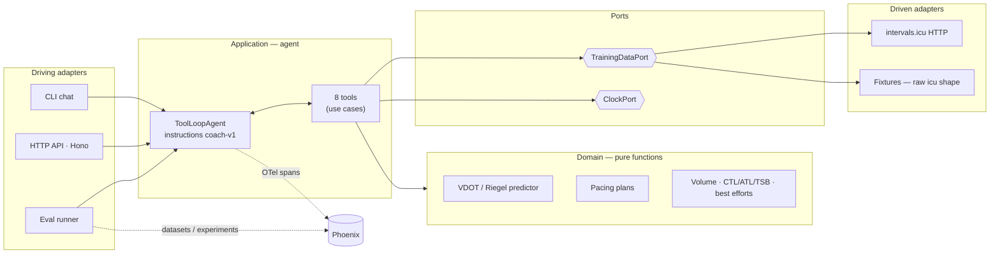

# 🏃 Running Coach Agent — POC

An agentic running coach that answers questions about **your intervals.icu data** ("Could I run a sub-2:55 marathon?", "How was my run today?", "Am I fresh for VMA tomorrow?"), with **Arize Phoenix** tracing, an **eval suite** used as a CI gate, and a clean hexagonal structure so the data source, model and UI can change independently.

Stack: TypeScript · Node 22 · Vercel AI SDK v7 (`ToolLoopAgent`) · Claude · Phoenix (`@arizeai/phoenix-otel`, `phoenix-client`, `phoenix-evals`) · Vitest · GitHub Actions.

---

## Quick start

### Everything in Docker (Phoenix + coach API)

```bash
cp .env.example .env                 # add ANTHROPIC_API_KEY (+ INTERVALS_API_KEY, DATA_SOURCE=intervals for live data)
docker compose up --build            # Phoenix UI → http://localhost:6006 · coach API → http://localhost:3000

curl localhost:3000/health
curl -X POST localhost:3000/chat -H 'content-type: application/json' \
     -d '{"message":"Could I run a sub 2:55 marathon?"}'
# → { sessionId, answer, tools, steps, usage } — send sessionId back to continue the conversation
```

The `coach` container exports traces to `http://phoenix:6006` over the compose network, uses fixtures unless `DATA_SOURCE=intervals`, and can reach a model server on your machine (Ollama/LM Studio) via `host.docker.internal`. Requires Docker Compose ≥ 2.24 (optional `env_file`).

### Local dev

```bash
npm install
cp .env.example .env
docker compose up -d phoenix         # just Phoenix
npm run serve:fixtures               # HTTP API on :3000 with the demo athlete
npm run chat:fixtures                # or the terminal REPL
npm run chat                         # your real data

npm test                             # offline: domain, adapter, agent loop (mock model), evaluators
npm run evals                        # golden dataset → Phoenix experiment → threshold gate
npm run evals -- --code-only         # skip LLM judges (cheaper)
```

---

## Architecture



```
src/
  domain/        pure logic: model, time, vdot, predictor, pacing, training, activity-summary
  ports/         TrainingDataPort, ClockPort
  adapters/
    intervals-icu/   HTTP adapter + zod schemas + raw→domain mappers (anti-corruption layer)
    fixtures/        replays recorded raw payloads through the SAME mappers
  agent/         tools.ts (use cases), instructions.ts (versioned prompt), coach-agent.ts
  observability/ telemetry.ts (AI SDK → OTel → Phoenix)
  config/        composition root (env → adapters, models)
  cli/           chat REPL
  server/        HTTP API (Hono): POST /chat, GET /health, DELETE /sessions/:id + SessionStore port
evals/           dataset, evaluators (code + LLM judges), run.ts (experiment + CI gate)
test/            vitest suites
```

### Key design decisions (and why)

| Decision | Why |
|---|---|
| **One agent + good tools, not multi-agent (yet)** | A single tool loop is easier to debug, cheaper and faster. Split into specialists only when evals show tool-selection confusion or the prompt becomes a grab-bag (see roadmap). |
| **LLM explains, domain computes** | Every time/pace/split comes from `predict_race_time` / `build_pacing_plan`. LLMs are bad at arithmetic and great at explanation — this is the #1 lever on groundedness, and it's unit-testable. |
| **Tools return small, pre-formatted JSON** | Raw intervals.icu activities have ~100 fields. Summaries ("4:14/km", "2:58:53") cut tokens and remove unit-conversion mistakes. |
| **Tool errors are values (`{error}`), not exceptions** | The model can recover ("no run found today — did you mean yesterday?") instead of the loop crashing. |
| **Hexagonal ports/adapters** | `TrainingDataPort` lets evals run on fixtures; adding Garmin/Strava later is a new adapter, no tool changes. |
| **Fixtures in raw API shape + relative dates** | They go through the real mapper (the ACL is tested), and "today's run" never goes stale. |
| **Injected clock** | Freezes "today" in tests/evals → reproducible scores. |
| **Versioned prompt (`coach-v1`)** | Attached to traces and experiment names, so Phoenix compares prompt versions on the same dataset. |

**Analogy:** the agent is the head coach in the conversation; the tools are the lab technicians with the stopwatch and the spreadsheet. The head coach never invents a lab result — he asks for it, then explains what it means for you.

---

## Observability (Phoenix)

`src/observability/telemetry.ts` does two things:
1. `registerTelemetry(new OpenTelemetry({ headers: false }))` — every AI SDK call (agent run, each LLM step, each tool execution) emits OpenTelemetry spans. Headers are excluded so API keys never land in traces.
2. `register({ projectName })` from `@arizeai/phoenix-otel` — converts spans to OpenInference and exports them to Phoenix.

Each conversational turn is wrapped in a root `coach.turn` **AGENT** span with `session.id` and metadata (`promptVersion`, `surface`), so in Phoenix you get:
- **Traces**: turn → LLM step → tool call → LLM step → answer, with inputs/outputs, latency, tokens.
- **Sessions**: whole conversations grouped by `session.id`.
- **Filters** on metadata: compare `coach-v1` vs `coach-v2`, CLI vs eval traffic.

What to look at first: tool calls with wrong arguments, answers given *without* a tool call, loops hitting `maxSteps`, and slow tools.

---

## Evals

Think of it as a test pyramid for a non-deterministic system:

| Layer | What | Where | Cost |
|---|---|---|---|
| Unit | Domain math, adapter mapping/retries, evaluators themselves | `test/` (vitest) | free, every push |
| Agent wiring | Full tool loop with `MockLanguageModelV4` | `test/coach-agent.test.ts` | free, every push |
| Behavioural (code evals) | `tool_selection`, `required_facts`, `numbers_grounded`, `step_budget` | `evals/evaluators.ts` | LLM calls for the agent only |
| Quality (LLM judges) | `groundedness`, `coaching_quality`, `safety` | `evals/evaluators.ts` | agent + judge calls |

- **Dataset** (`evals/dataset.ts`): 10 golden questions (prediction EN/FR, activity review, readiness, volume, pacing, injury safety, out-of-scope). Expectations are *behavioural* (which tools must/must not be called, which facts must appear) rather than reference answers.
- **`numbers_grounded`** is the cheap hallucination detector: every `h:mm:ss` / `m:ss` token in the answer must exist (±1%) in tool outputs or the question.
- **LLM judges** use a smaller model than the agent with binary/ternary labels. Calibrate them on ~20 traces you've labelled yourself before trusting them as a hard gate.
- **Gate**: `evals/thresholds.json` (mean score per evaluator). Start slightly below your first baseline, ratchet up.
- **Flywheel**: bad answer in a Phoenix trace → add that question to the dataset → fix → the experiment proves it.

---

## CI/CD

| Workflow | Trigger | What |
|---|---|---|
| `ci.yml` | push / PR | `typecheck` + `vitest` — no secrets, no LLM · `docker build` + `/health` smoke test |
| `evals.yml` | PR touching `src/`, `evals/`, `fixtures/`, lockfile | golden dataset → Phoenix experiment → **fails the PR** below threshold; report in the job summary |
| `evals.yml` | nightly | 3 repetitions → variance + provider drift detection |

Secrets: `ANTHROPIC_API_KEY` (required), `PHOENIX_HOST` + `PHOENIX_API_KEY` (optional — persistent Phoenix Cloud/self-hosted instance so experiments are comparable across PRs; otherwise an ephemeral Phoenix service container is used).

**CD (next step):** push the image to a registry → deploy to staging → run evals against staging → promote. In production: sample live traces into Phoenix, run the LLM judges online on a percentage of traffic, and promote prompt versions only when the offline experiment beats the current one.

---

## Roadmap

1. **Validate on your real data**: add a `record-fixture` script (pull your intervals.icu data, anonymise) and grow the golden dataset from your own questions.
2. **Pace curves**: replace whole-activity best efforts with the intervals.icu pace-curve endpoint (best 10k *inside* a long run). Confirm the response shape in the Swagger UI first.
3. **Race planning**: a `race` entity (date, distance, course profile, goal) persisted per athlete; tools for "weeks until race" and taper/build phase checks; write planned workouts back to intervals.icu (events API).
4. **Multi-agent, when evals justify it**: an orchestrator routing to *specialists as tools* (Analyst: data questions · Planner: blocks/workouts · Race strategist: pacing/fueling). Same eval dataset, new experiment — keep it only if scores improve.
5. **Memory**: athlete preferences/injury history (with consent) as a store the agent reads — not RAG.
6. **RAG (later)**: a curated corpus of training methodology (Daniels, Pfitzinger, French VMA/seuil literature) with citations — evaluate with retrieval-relevance evals.
7. **UI**: stream `agent.stream()` over SSE from the HTTP API to a mobile/web client; move sessions from memory to Redis/Postgres (same `SessionStore` port).

## Known limitations

- Prediction adjustments for volume/long runs are **coaching heuristics**, labelled as such in tool output.
- Form zones approximate intervals.icu's (TSB as % of CTL).
- Activities imported into intervals.icu **from Strava are not exposed by its API** — sync Garmin directly.
- LLM judges are not yet calibrated against human labels.

## Sources

- intervals.icu API access (Basic auth `API_KEY:<key>`, athlete `0`, endpoints): https://forum.intervals.icu/t/api-access-to-intervals-icu/609 · Swagger: https://intervals.icu/api/v1/docs/swagger-ui/index.html
- intervals.icu API cookbook (wellness/activities endpoints): https://forum.intervals.icu/t/intervals-icu-api-integration-cookbook/80090
- Phoenix × Vercel AI SDK v7 tracing: https://www.arize.com/docs/phoenix/integrations/typescript/vercel/vercel-ai-sdk-tracing-js.md
- Phoenix TS experiments (`runExperiment`, `asExperimentEvaluator`, trace-based evals): https://www.arize.com/docs/phoenix/sdk-api-reference/typescript/packages/phoenix-client/experiments.md
- `@arizeai/phoenix-evals`: https://arize.com/docs/phoenix/sdk-api-reference/typescript/arizeai-phoenix-evals
- Phoenix Docker self-hosting: https://www.arize.com/docs/phoenix/self-hosting/deployment-options/docker.md
- Anthropic — Writing effective tools for agents: https://www.anthropic.com/engineering/writing-tools-for-agents
