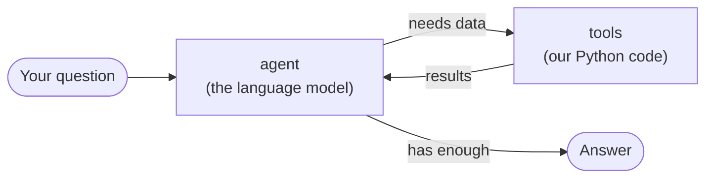
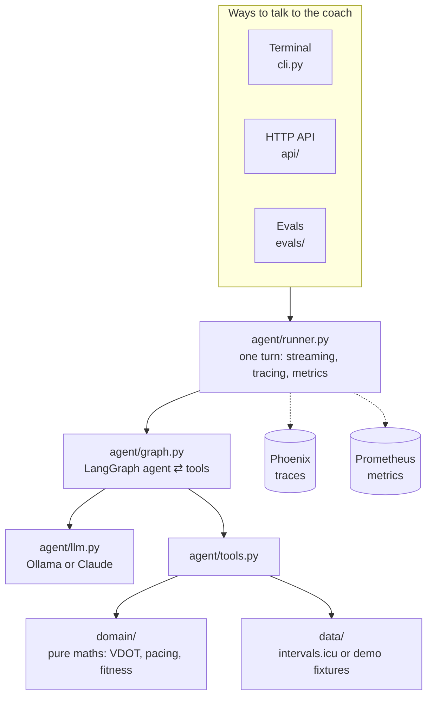

# 🏃 Running Coach

An AI running coach that answers questions about **your own training data** from [intervals.icu](https://intervals.icu):

> *"Could I run a sub-2:55 marathon?"* · *"How was my run today?"* · *"Am I fresh enough for a hard session tomorrow?"* · *"Give me a pacing plan for 2:58."*

It runs on a **local model** (Ollama) or Claude, shows its work with **traces** (Phoenix) and **metrics** (Prometheus), and has an **eval suite** that can block a pull request if answer quality drops.

**Built with:** Python 3.13 · [uv](https://docs.astral.sh/uv/) · [LangGraph](https://docs.langchain.com/oss/python/langgraph/overview) · Ollama / Claude · FastAPI · Arize Phoenix · Prometheus · pytest · ruff

> This is a proof of concept and a learning project. It's meant to grow, so the code favours clarity over cleverness.

---

## Contents

1. [Try it in 5 minutes](#1-try-it-in-5-minutes)
2. [Everyday commands](#2-everyday-commands)
3. [Using the HTTP API](#3-using-the-http-api)
4. [How it works](#4-how-it-works)
5. [Configuration](#5-configuration)
6. [Seeing what the coach does](#6-seeing-what-the-coach-does)
7. [Testing and evals](#7-testing-and-evals)
8. [CI/CD](#8-cicd)
9. [Roadmap and known limitations](#9-roadmap-and-known-limitations)

---

## 1. Try it in 5 minutes

**You need:** [uv](https://docs.astral.sh/uv/getting-started/installation/), [Ollama](https://ollama.com/download) and Docker (Docker is only for the tracing UI).

```bash
uv sync                          # install dependencies into .venv
cp .env.example .env             # default settings work as-is
ollama pull qwen3:14b            # the local model (any Ollama model with tool calling works)
docker compose up -d phoenix     # optional: tracing UI at http://localhost:6006

uv run coach-chat --fixtures     # chat in your terminal with a built-in demo athlete
```

`--fixtures` uses a made-up athlete (about 70 km/week, a 1:24 half marathon last week), so you don't need an intervals.icu account to try it.

**To use your real data:** put your key in `.env` (`INTERVALS_API_KEY=…`, from intervals.icu → Settings → Developer) and run `uv run coach-chat` without the flag.

> 💡 A 14B model on a local GPU takes tens of seconds per answer, because the coach calls several tools before it replies. Tokens stream as they arrive, so you'll see it working.

---

## 2. Everyday commands

| I want to… | Run |
|---|---|
| Chat in the terminal | `uv run coach-chat` (add `--fixtures` for the demo athlete) |
| Start the HTTP API | `uv run coach-serve --fixtures` → docs at http://localhost:3000/docs |
| Run everything in Docker | `docker compose up --build` (API :3000, Phoenix :6006, Prometheus :9090) |
| Step through the agent visually | `uv run langgraph dev` (LangGraph Studio) ¹ |
| Run the tests | `uv run pytest` (offline, no model needed) |
| Lint and format | `uv run ruff check . && uv run ruff format .` |
| Run the quality evals | `uv run python -m evals.run` (add `--code-only` to skip the LLM judges) |
| Regenerate the demo athlete | `uv run python scripts/generate_fixture.py` |

¹ On Windows, set `PYTHONUTF8=1` first, otherwise its log output hits encoding errors.

---

## 3. Using the HTTP API

Start it with `uv run coach-serve --fixtures`. The interactive docs are at `/docs`.

| Endpoint | What it does |
|---|---|
| `GET /health` | Is the server up, and which data source is it using? |
| `POST /chat` | Ask a question, get **one complete JSON answer** |
| `POST /chat/stream` | Ask a question, get the answer **piece by piece** (Server-Sent Events) |
| `DELETE /sessions/{id}` | Forget a conversation |
| `GET /metrics` | Prometheus metrics |

### Ask a question

```bash
curl -X POST localhost:3000/chat -H 'content-type: application/json' \
     -d '{"message": "Could I run a sub 2:55 marathon?"}'
# → { "sessionId": "…", "answer": "…", "tools": ["predict_race_time"], "steps": 2, "usage": {…} }
```

To keep the conversation going, send the `sessionId` back with your next message: `{"message": "And what about 3:00?", "sessionId": "…"}`.

### Stream the answer

```bash
curl -N -X POST localhost:3000/chat/stream -H 'content-type: application/json' \
     -d '{"message": "How was my run today?"}'
```

You'll receive a series of events as the coach works:

| Event | Meaning | Example data |
|---|---|---|
| `session` | The conversation id (always first) | `{"sessionId": "…"}` |
| `tool_call` | The coach is fetching something | `{"name": "get_activity_details", "input": {…}}` |
| `tool_result` | …and here's what it got | `{"name": "…", "output": {…}}` |
| `token` | A few words of the answer (many of these) | `{"text": "Your run"}` |
| `done` | Finished; same body as `POST /chat` | `{"answer": "…", "tools": […]}` |
| `error` | Something went wrong | `{"message": "…"}` |

A web app can show "Analysing your fitness…" on `tool_call` and then print the answer as `token` events arrive.

<details>
<summary><b>Why Server-Sent Events and not WebSockets?</b></summary>

The data only flows one way (server → browser), and SSE is plain HTTP: it works with `curl`, with `fetch()` in browsers and apps, and through proxies, with no connection state to manage. Closing the connection cancels the running agent. WebSockets only become worthwhile when the client must talk *during* an answer, for example to interrupt it or approve an action.

Browsers' built-in `EventSource` only supports `GET`, and this endpoint is a `POST`, so a React app should read the stream with `fetch()` (or the `@microsoft/fetch-event-source` library).
</details>

---

## 4. How it works

### The loop



This is a LangGraph graph ([`agent/graph.py`](src/running_coach/agent/graph.py)). It has two nodes, `agent` and `tools`, in a loop, capped at 8 model calls per question. Conversations are stored by LangGraph's checkpointer, keyed by session id.

### The tools

| Tool | Use it for |
|---|---|
| `get_athlete_snapshot` | "How is my training going?" (fitness, fatigue, recent volume) |
| `list_recent_activities` | Finding a specific run |
| `get_activity_details` | "How was my run today?" (including interval paces) |
| `get_fitness_trend` | "Am I fresh? Am I overtraining?" |
| `get_training_volume` | Weekly kilometres and long runs |
| `get_best_efforts` | Best recent 5k / 10k / half / marathon efforts |
| `predict_race_time` | "Could I run X in Y?" (VDOT model, adjusted for volume and long runs) |
| `build_pacing_plan` | Race splits, even or negative |

### The big picture



### Project layout

```
src/running_coach/
  settings.py     all configuration, read once from the environment / .env
  observability.py  traces → Phoenix, metrics → Prometheus
  domain/         pure logic, no I/O (easy to test): models, dates, vdot, predictor, pacing, training
  data/           where training data comes from: intervals.icu client, demo fixtures
  agent/          prompts, tools, graph, runner, llm (picks the model: "ollama:qwen3:14b" or "anthropic:claude-…")
  api/            FastAPI app and routes
  cli.py          terminal chat
evals/            quality tests for the AI (dataset, scoring, CI gate)
tests/            fast offline tests; mirrors src/
fixtures/         the demo athlete
```

Dependencies point inward: the API and CLI use the agent, the agent uses the tools, and the tools use `domain` and `data`. `domain` knows nothing about HTTP, LLMs or intervals.icu.

### Design decisions

| Decision | Why |
|---|---|
| **One agent with good tools** (not many agents) | Easier to debug, cheaper and faster. Split into specialists only when evals show the single agent struggling. |
| **The model explains, the code computes** | Removes made-up numbers, and the maths is unit-tested. |
| **Tools return small, pre-formatted JSON** | Raw intervals.icu data has ~100 fields per activity. Sending "4:14/km" instead of metres per second saves tokens and avoids unit mistakes. |
| **Tool errors are values, not exceptions** | The model can recover ("no run found today, shall I check yesterday?") instead of crashing. |
| **A `TrainingData` interface** | Tests and evals use the demo athlete; Garmin or Strava later means a new class and no tool changes. |
| **Demo data uses relative dates and the real mappers** | "Today's run" never goes stale, and the intervals.icu mapping code is exercised by tests. |
| **Injected clock** | "Today" is frozen in tests and evals, so scores are reproducible. |
| **Failed turns roll back** | If something crashes mid-answer, the conversation returns to its last good state, so a retry is safe. |
| **Versioned prompt** (`coach-v1`) | Stored in every trace and experiment, so you can compare prompt versions. |

---

## 5. Configuration

Settings come from environment variables or a `.env` file (copy [`.env.example`](.env.example)).

| Variable | Default | Meaning |
|---|---|---|
| `DATA_SOURCE` | `intervals` | `intervals` (your data) or `fixtures` (demo athlete) |
| `INTERVALS_API_KEY` | – | Your intervals.icu key (not needed for fixtures) |
| `COACH_MODEL` | `ollama:qwen3:14b` | The coach's model, as `provider:model` |
| `JUDGE_MODEL` | `ollama:qwen3:14b` | The model that grades answers in the evals |
| `OLLAMA_BASE_URL` | `http://localhost:11434` | Where Ollama is running |
| `ANTHROPIC_API_KEY` | – | Needed only for Claude models |
| `PHOENIX_COLLECTOR_ENDPOINT` | – | Where to send traces; leave empty to disable tracing |
| `ATHLETE_TIMEZONE` | `America/Toronto` | Defines what "today" means |

### Switching to Claude

```bash
COACH_MODEL=anthropic:claude-sonnet-5-5
JUDGE_MODEL=anthropic:claude-haiku-4-5
ANTHROPIC_API_KEY=sk-ant-…
```

Adding another provider (OpenAI, Bedrock, vLLM…) is one extra `case` in [`agent/llm.py`](src/running_coach/agent/llm.py).

---

## 6. Seeing what the coach does

### Traces: Phoenix → http://localhost:6006

Every question becomes a trace: the question, each model call with its full prompt and answer, each tool call with its arguments and result, plus timing and token counts. Conversations are grouped as **sessions**.

To find a model call, open a trace and click the `ChatOllama` entry in the tree; the Input and Output tabs show the full prompt and answer. The `coach.turn` span at the top summarises each question: the question, the answer, the tools used, the number of steps and token usage.

What to look at first: tool calls with wrong arguments, answers given *without* any tool call, questions that hit the 8-step limit, and slow tools.

FastAPI can also add its own HTTP spans (`POST /chat`, …). They're controlled by the `telemetry=` setting in [`api/app.py`](src/running_coach/api/app.py). They carry no LLM data, so turning them off keeps `coach.turn` as the root of each trace.

### Metrics: Prometheus → http://localhost:9090

Metrics answer "how is it doing overall?" rather than "what happened in this one chat?". The API exposes them at `/metrics` and Prometheus collects them every 15 seconds.

| Metric | Tells you |
|---|---|
| `coach_turn_duration_seconds` (by `outcome`: ok / error) | How slow is an answer, and how often does one fail? |
| `coach_turn_steps` | How many model calls does a question need? (limit: 8) |
| `coach_tokens_total` (by `type`: input / output) | How many tokens are being used |
| `coach_tool_calls_total` (by `tool`) | Which tools the model actually uses |
| `http_server_request_duration_seconds` and friends | Standard API health, from FastAPI |

Handy queries to paste into Prometheus:

```promql
histogram_quantile(0.95, sum by (le) (rate(coach_turn_duration_seconds_bucket[5m])))   # slowest 5% of answers
sum by (outcome) (rate(coach_turn_duration_seconds_count[5m]))                         # success vs error rate
sum by (tool) (increase(coach_tool_calls_total[1h]))                                   # tool usage in the last hour
```

---

## 7. Testing and evals

Testing an AI system has two parts: checking that the *code* is right, and checking that the *answers* are good.

| Layer | What it checks | Cost |
|---|---|---|
| **Unit tests** (`uv run pytest`) | The maths, intervals.icu parsing and retries, the graph loop, streaming, rollback, the HTTP and SSE API. A scripted fake model stands in for the real one. | Free and instant; runs on every push |
| **Code evals** (`uv run python -m evals.run --code-only`) | With the real model: did it call the right tools? Does the answer contain the key facts? Is every time or pace it quotes found in the tool data (a cheap made-up-number detector)? Did it stay within 5 steps? | Model calls only |
| **LLM judges** (`uv run python -m evals.run`) | A second model grades the answers for *groundedness*, *coaching quality* and *safety*. | Model + judge calls |

The golden dataset ([`evals/dataset.py`](evals/dataset.py)) has 10 questions covering predictions (English and French), activity review, readiness, volume, pacing, injury safety and out-of-scope topics. Each one states *behaviour* ("must call `predict_race_time`", "must not give a pacing plan for an injury question") rather than a fixed expected answer.

**The gate:** [`evals/thresholds.json`](evals/thresholds.json) sets a minimum average score per measure. The run fails (exit code 1) if any falls below, and CI uses that to block pull requests. Results are stored in Phoenix as experiments, so you can compare runs side by side.

**The improvement loop:** spot a bad answer in a Phoenix trace → add that question to the dataset → fix the prompt or tool → the next experiment proves it.

---

## 8. CI/CD

| Workflow | When | What |
|---|---|---|
| [`ci.yml`](.github/workflows/ci.yml) | Every push and PR | Lint, format check and unit tests (no secrets, no model), then build the Docker image and check `/health` |
| [`evals.yml`](.github/workflows/evals.yml) | PRs touching `src/`, `evals/`, `fixtures/` or `uv.lock` | Runs the golden dataset and **fails the PR** if any score is below its threshold |
| [`evals.yml`](.github/workflows/evals.yml) | Nightly | 3 repetitions per question, to measure variance and spot provider-side drift |

GitHub's runners have no GPU, so the CI evals use **Claude** through the same `provider:model` switch (override with the repo variables `COACH_MODEL` and `JUDGE_MODEL`). You need the `ANTHROPIC_API_KEY` secret. `PHOENIX_HOST` and `PHOENIX_API_KEY` are optional: set them to keep experiments across runs; otherwise a throwaway Phoenix container is used.

---

## 9. Roadmap and known limitations

### Where it could go next

1. **Test on your real data:** a script to record and anonymise your own intervals.icu data, and a dataset grown from your own questions.
2. **Better best efforts:** use intervals.icu's pace curves (your best 10k *inside* a long run) instead of whole-run times.
3. **Race planning:** store a goal race per athlete, add taper and build-phase checks, and write planned workouts back to intervals.icu.
4. **Several specialists, if evals justify it:** a router in front of an analyst, a planner and a race strategist. Keep it only if scores improve.
5. **Persistent conversations:** swap the in-memory store for Postgres or SQLite, and add trimming or summarising for long chats.
6. **Memory:** preferences and injury history (with consent).
7. **Human approval:** pause for confirmation before writing anything to intervals.icu. This is when WebSockets or a resume endpoint start to make sense.
8. **Training-science knowledge base** (Daniels, Pfitzinger, …) with citations.
9. **An OpenTelemetry Collector:** the app pushes once, and the Collector fans traces out to Phoenix and metrics to Prometheus.

### Known limitations

- Race-prediction adjustments for volume and long runs are **coaching heuristics**, labelled as such in the tool output.
- Fitness "form zones" approximate intervals.icu's own.
- Activities that intervals.icu imported **from Strava are not available through its API**; sync from Garmin directly.
- The `numbers_grounded` eval reads a rounded "2:58" as minutes:seconds, so it flags rounded marathon times (the style the prompt itself suggests). Either compare `h:mm` against tool times or change the prompt example.
- The LLM judges haven't been calibrated against human labels yet.
- If a question needs more than 8 model calls, it fails with an error rather than returning a partial answer.
- Conversations live in memory and are lost when the server restarts.
- CORS in [`api/app.py`](src/running_coach/api/app.py) currently allows only placeholder origins; add your front-end's address before calling the API from a browser app.
- `uv run langgraph dev` runs on a `langgraph-api` release that needs an override for an OpenTelemetry version conflict (explained in [`pyproject.toml`](pyproject.toml)).

---

<details>
<summary><b>Sources</b></summary>

- intervals.icu API access: https://forum.intervals.icu/t/api-access-to-intervals-icu/609 · Swagger: https://intervals.icu/api/v1/docs/swagger-ui/index.html
- intervals.icu API cookbook: https://forum.intervals.icu/t/intervals-icu-api-integration-cookbook/80090
- LangGraph: https://docs.langchain.com/oss/python/langgraph/overview · Studio: https://docs.langchain.com/langsmith/studio
- Phoenix × LangChain tracing: https://arize.com/docs/phoenix/integrations/python/langchain
- Phoenix experiments: https://arize.com/docs/phoenix/datasets-and-experiments/how-to-experiments/run-experiments
- FastAPI Server-Sent Events: https://fastapi.tiangolo.com/advanced/server-sent-events/
- uv: https://docs.astral.sh/uv/guides/projects/
- Anthropic, *Writing effective tools for agents*: https://www.anthropic.com/engineering/writing-tools-for-agents

</details>
